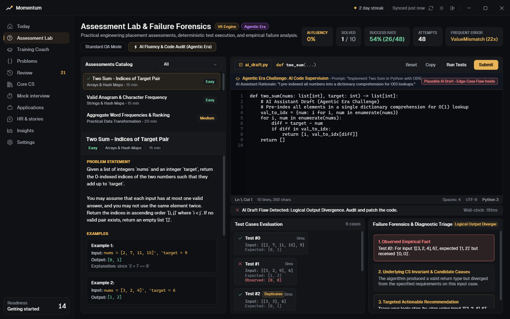
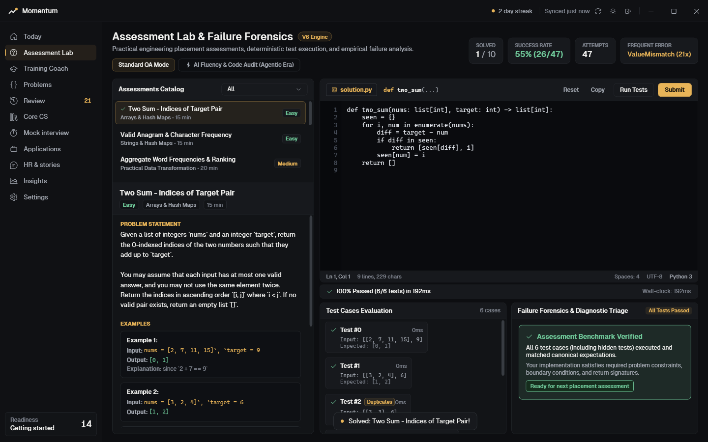
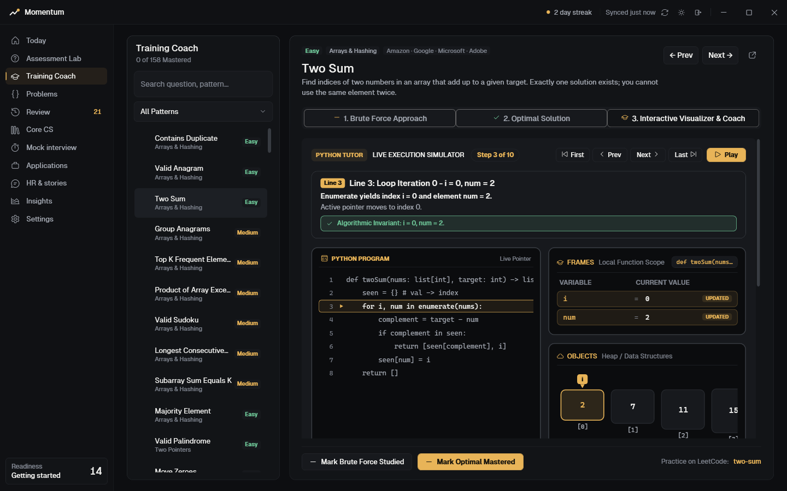
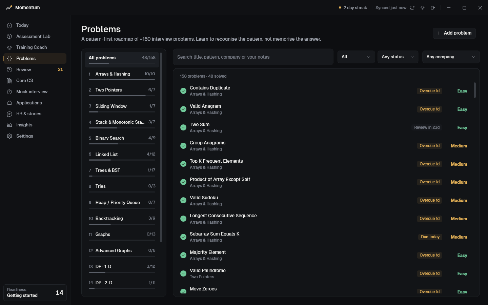

# Momentum: Software Engineering Placement & Assessment Lab

[](https://dotnet.microsoft.com/)
[]()
[-success.svg)]()
[](LICENSE)
[]()

> **A Windows desktop application engineered for final-year engineering students preparing for technical placement assessments and software engineering interviews.**  
> Featuring an evidence-based **Failure Forensics** engine that diagnoses execution failures into underlying computer science invariants rather than generic "Wrong Answer" errors.

---

## 1. The Problem Momentum Solves

Software engineering placement assessments and Online Assessments (OAs) rarely test whether candidates have memorized algorithmic solutions; they test **practical implementation**, **edge-case handling**, **boundary condition stability**, and **systematic debugging under timed conditions**.

Traditional practice platforms provide binary verdicts: `Wrong Answer` or `Accepted`. When an assessment submission fails, candidates are left guessing or looking up full spoilers, missing the opportunity to build diagnostic debugging intuition.

**Momentum** transforms placement preparation into a diagnostic discipline:
1. **Practical Assessment Lab**: A focused IDE experience with verified test cases, edge-case tags, and hidden validation suites.
2. **Failure Forensics**: When an assessment fails, Momentum analyzes empirical execution traces, AST compilation states, and output variances to classify the error category, explain the root computer science invariant, and prescribe an actionable next step without revealing the answer.
3. **Placement Drive Pipeline**: A 5-stage Kanban board tracking applications, interview rounds, package details, and company-specific focus topics.
4. **Local-First & Offline**: All state, attempts, and code are persisted locally in `%LOCALAPPDATA%\Momentum\momentum.json` using atomic writes with zero cloud telemetry.

---

## 2. Application Screenshots

### Agentic Era Assessment: AI Fluency & Code Supervision Mode
> *Simulating next-generation technical hiring (e.g. HackerRank Chakra & Plan Mode). Candidates supervise, audit, and patch simulated AI drafts designed to reproduce common LLM implementation patterns and latent boundary flaws.*


### Standard Placement Assessment Lab & Failure Forensics
> *Deterministic local Python 3 execution with wall-clock runtime telemetry, public/hidden test suites, and empirical diagnostic triage.*


### Interactive Python Visual Tutor & Live Execution Simulator


### Curated DSA Roadmap & Spaced Repetition Catalog


---

## 3. Core Architecture

Momentum is built using a clean, layered MVVM architecture on .NET 8 WPF with an out-of-process execution harness:

```
┌────────────────────────────────────────────────────────────────────────┐
│                        Momentum WPF Client (MVVM)                      │
│                                                                        │
│   ┌────────────────────────┐         ┌──────────────────────────────┐  │
│   │   AssessmentLabView    │◄───────►│   AssessmentLabViewModel     │  │
│   │   - Resizable splitter │ (MVVM)  │   - Auto-saving user code    │  │
│   │   - Monospace editor   │         │   - Real-time telemetry      │  │
│   │   - Forensics card     │         │   - Async process dispatch   │  │
│   └────────────────────────┘         └──────────────┬───────────────┘  │
│                                                     │                  │
│                                                     ▼                  │
│   ┌─────────────────────────────────────────────────────────────────┐  │
│   │               Failure Forensics & Evaluation Core               │  │
│   │                                                                 │  │
│   │   ┌────────────────────────┐        ┌───────────────────────┐   │  │
│   │   │ PythonExecutionHarness │        │ FailureForensicsEngine│   │  │
│   │   │ - Out-of-proc runner   │───────►│ - Diagnostic triage   │   │  │
│   │   │ - Bounded execution    │        │ - Evidence taxonomy   │   │  │
│   │   │ - Quarantined IPC      │        │ - Actionable guidance │   │  │
│   │   └────────────────────────┘        └───────────────────────┘   │  │
│   └─────────────────────────────────────────────────────────────────┘  │
│                                     │                                  │
│                                     ▼                                  │
│   ┌─────────────────────────────────────────────────────────────────┐  │
│   │               Local-First JSON State Persistence                │  │
│   │   - Atomic temp + rolling .bak file writes                      │  │
│   │   - Zero cloud telemetry; complete offline operation            │  │
│   └─────────────────────────────────────────────────────────────────┘  │
└─────────────────────────────────┬──────────────────────────────────────┘
                                  │ Subprocess invocation (isolated stdio)
                                  ▼
┌────────────────────────────────────────────────────────────────────────┐
│                     Out-of-Process Python Runner                       │
│   - Python 3.8+ system discovery                                       │
│   - Environment-variable filtering & bounded stream capture            │
│   - In-place mutation detection via deep-copy snapshots                │
│   - Canonical JSON comparison with float epsilon (1e-6)                │
│   - Enforced 3000ms wall-clock timeout with process tree termination   │
└────────────────────────────────────────────────────────────────────────┘
```

### Technology Stack
- **Framework**: .NET 8.0 (C# 12)
- **UI Architecture**: WPF (Windows Presentation Foundation) with MVVM pattern
- **Execution Engine**: Out-of-process subprocess runner for Python 3.8+
- **Serialization**: `System.Text.Json` with atomic temporary file writes and rolling `.bak` backups
- **Credential Storage**: Windows Data Protection API (DPAPI) used specifically for mail sync secrets in `MailSyncService`
- **Embedded Browser**: Microsoft Edge WebView2

---

## 4. The Signature Feature: Failure Forensics

The Failure Forensics Engine evaluates empirical execution traces, AST compilation states, and output variances into an explainable taxonomy:

| Failure Taxonomy | Empirical Trigger | Architectural / Conceptual Invariant | Actionable Recommendation |
|---|---|---|---|
| **SyntaxError** | Python parser fails `compile()` with line and offset | Grammatical rules and indentation boundaries must be satisfied prior to bytecode generation | Inspect highlighted line for missing colons (`:`), unmatched parentheses, or tab/space mixture |
| **TimeLimitExceeded** | Wall-clock execution exceeds 3,000ms threshold | Non-advancing while-loops, unbounded recursion, or quadratic $O(N^2)$ algorithmic time complexity | Verify while-loop advancement conditions and base-case termination |
| **EmptyInputOrBoundary** | `IndexError` on empty collection (`[]`, `""`) | Algorithmic functions must guard against index access on empty structures (`[]` or `""`) before accessing elements | Add an early guard clause `if not arr: return ...` at the top of the function |
| **Sequence Index Out of Range** | `IndexError` on non-empty sequence | Loop or pointer boundary exceeded valid index range `[0, len-1]` | Inspect loop inequality (`< len(arr)` vs `<= len(arr)`) and boundary pointer updates |
| **Dictionary Key Not Found** | `KeyError` during mapping lookup | Direct indexing `dict[key]` raises KeyError if the key does not exist | Use `dict.get(key, default)` or verify presence with `if key in dict:` |
| **Zero Division Fault** | `ZeroDivisionError` during arithmetic | Denominator evaluated to zero, often from zero-length collections or matching pointers | Add a guard clause verifying denominators are non-zero before division |
| **InputMutationSideEffect** | Argument modified in-place (`args != args_copy`) | In Python, lists and dicts are passed by reference; mutating them in-place introduces caller side-effects | Use non-destructive operations (`sorted()` instead of `.sort()`) or copy via `arr.copy()` |
| **TypeOrHashability** | `TypeError: unhashable type: 'list'` or incompatible operations | Python collections require immutable items for hashing in sets and dictionary keys | Convert mutable collections to immutable equivalents (e.g. `tuple(arr)`) |
| **OutputFormatting** | Function returned `None` or invalid shape | Implicit `None` returned due to missing explicit `return` along a code path | Verify all execution branches return the computed object |
| **OffByOneOrSlice** | Numerical return off by 1 or list length offset by 1 | Candidate off-by-one discrepancy in loop bounds, range termination, or counter initialization | Verify range boundaries (`len(nums)` vs `len(nums) - 1`) and slice upper bounds |
| **ValueMismatch** | Algorithm produces correct types but diverges from canonical output | Algorithmic logic failure or untested edge case (e.g. duplicates, negatives, sorted order) | Trace logic step-by-step against sample input to isolate deviation |

### Hidden Test Case Protection
To preserve placement assessment realism, hidden test inputs and expected outputs are **withheld from candidate-facing UI and diagnostic messages, as verified by the automated test suite**. If a candidate fails a hidden test, the Failure Forensics engine identifies the failure category and provides conceptual guidance without exposing the underlying test data.

---

## 5. Built for the Agentic Era: AI Fluency & Code Supervision

Technical assessment and hiring platforms (pioneered by **HackerRank's Chakra AI Interviewer** and **Agentic Era Assessments**) are undergoing a profound paradigm shift: **software engineering interviews no longer measure raw keystroke speed or boilerplate generation; they measure a candidate's ability to supervise, audit, and rigorously verify AI-generated code.**

When engineers use AI coding agents (Copilot, Cursor, Devin), the highest-leverage skill is **AI Fluency**: detecting subtle edge-case traps, latent state mutations, and invariant violations in code that looks plausible at first glance.

Momentum is designed specifically around this new industry standard:

```
┌────────────────────────────────────────────────────────────────────────┐
│               The Agentic Era Assessment Supervision Flow              │
│                                                                        │
│   ┌───────────────────────────┐         ┌───────────────────────────┐  │
│   │   AI Assistant Prompt     │────────►│   Plausible Code Draft    │  │
│   │   "Implement Two Sum in   │         │   (Syntactically valid,   │  │
│   │    Python with O(1) hash" │         │    passes basic tests)    │  │
│   └───────────────────────────┘         └─────────────┬─────────────┘  │
│                                                       │                │
│                                                       ▼                │
│   ┌───────────────────────────┐         ┌───────────────────────────┐  │
│   │   Empirical Forensics     │◄────────│   Latent Invariant Bug    │  │
│   │   - Input: [[3, 3], 6]    │ (Crash/ │   (Dict comprehension     │  │
│   │   - Output: [] (loss)     │  Fail)  │    overwrites duplicates) │  │
│   └─────────────┬─────────────┘         └───────────────────────────┘  │
│                 │                                                      │
│                 ▼                                                      │
│   ┌───────────────────────────┐         ┌───────────────────────────┐  │
│   │   Human Code Audit        │────────►│   Deterministic Patch     │  │
│   │   Candidate identifies    │ (Verify)│   Single-pass check       │  │
│   │   lost index 0 invariant  │         │   100% hidden tests pass  │  │
│   └───────────────────────────┘         └───────────────────────────┘  │
└────────────────────────────────────────────────────────────────────────┘
```

### Key AI Fluency Capabilities:
1. **Curated AI-Style Drafts with Seeded Latent Flaws**: Each challenge includes a simulated AI draft designed to reproduce common LLM implementation patterns and edge-case oversights that compile cleanly and pass sample cases, but fail on deeper invariant checks:
   - *Dictionary Key Overwrites*: Dict comprehensions wiping duplicate keys (`{num: i for i, num in enumerate(nums)}` failing on `[3, 3]`).
   - *Frequency Blindness*: Using `set()` equality for anagram checks, missing count mismatches (`"aab"` vs `"abb"`).
   - *Non-Advancing Half-Open Intervals*: Binary search range updates (`left = mid`) triggering infinite loop timeouts.
   - *In-Place Mutation*: Calling `list.sort()` directly on caller arguments, corrupting upstream caller invariants.
2. **Explicit Separation of Evidence and Hypotheses**:
   - **Seeded Defect**: The underlying flaw intentionally structured into the simulated draft.
   - **Empirical Output**: The concrete test failure recorded by the runner (e.g. `returned [] for input [[3, 3], 6]`).
   - **Diagnostic Hypothesis**: The Failure Forensics engine's explanation of the probable CS invariant violation, guiding the candidate without revealing the answer.
3. **AI Stated Assumptions vs. Reality**: The UI exposes the simulated AI rationale (e.g. *"Precomputed dictionary for clean O(N) lookup"*) alongside the empirical failure triage, training candidates to question AI assumptions.
4. **AI Fluency Telemetry & Progress**: Tracks audited questions and computes an objective AI Fluency score alongside standard OA metrics.

---

## 6. Curated Assessment Catalog

Momentum includes 10 thoroughly validated placement problems across core screening topics:

1. **Two Sum - Indices of Target Pair** (*Arrays & Hash Maps*, Easy) - $O(N)$ hash-table lookup.
2. **Valid Anagram & Frequency Analysis** (*Strings & Hash Maps*, Easy) - Case-insensitive character frequency hashing.
3. **Aggregate Word Frequencies & Ranking** (*Practical Data Transformation*, Medium) - Composite key sorting `(-count, word)` with regex tokenization.
4. **Merge Overlapping Time Intervals** (*Arrays & Sorting*, Medium) - Greedy interval merging via start-time sort.
5. **Reverse Words in a String** (*Strings & Two Pointers*, Medium) - Whitespace normalization and two-pointer reversal.
6. **Binary Search in Rotated Sorted Array** (*Searching & Boundary Conditions*, Medium) - Monotonic half identification in $O(\log N)$.
7. **Longest Substring Without Repeating Characters** (*Sliding Window & Sets*, Medium) - Dynamic window pointer jumps.
8. **Deep Flatten & Clean Nested Dictionary** (*Practical Logic & Recursion*, Medium) - Dot-notation tree recursion with strict null/empty predicate filtering.
9. **Debug: Fix Range Binary Search** (*Debugging Existing Code*, Medium) - Stabilizing boundary updates and off-by-one bugs.
10. **Validate Bracket Nesting with Strict Pairing** (*Stack & Edge Case Resilience*, Medium) - LIFO grammar verification.

---

## 7. Execution Security & Process Isolation (Honest Technical Assessment)

Executing user-supplied Python code carries inherent security implications. Momentum applies the following defense-in-depth principles while documenting absent protections with complete technical honesty:

### Implemented Safeguards:
1. **Zero Main-Process Execution**: Untrusted Python code is **never** executed inside the main WPF application process or CLR runtime. Execution occurs in a spawned OS worker subprocess.
2. **Standard Output Redirection & Quarantined Protocol**: The execution harness intercepts `sys.stdout` using in-memory streams during code execution. User print statements cannot corrupt the JSON IPC protocol or cause stream desynchronization.
3. **Bounded Buffers (Memory Exhaustion Protection)**: Both standard output and standard error event readers enforce strict 64 KB per-channel capture limits, preventing Denial-of-Service (DoS) buffer bloating from print flooding.
4. **Environment Variable Filtering**: Prior to spawning `python.exe`, sensitive environment variables (`MOMENTUM_DATA_DIR`, `APPDATA`, `LOCALAPPDATA`, `USERPROFILE`) are omitted from the child process environment block.
5. **Enforced Wall-Clock Timeout & Process Tree Termination**: Execution is bounded by a strict wall-clock timer (default 3,000ms). If an execution exceeds this budget or if the user cancels execution, `process.Kill(entireProcessTree: true)` terminates the runner and any child processes.
6. **Ephemeral Working Directory Isolation**: Every evaluation executes inside a uniquely generated temporary directory (`Path.GetTempPath() \ MomentumAssessmentLab \ <guid>`), which is cleaned up immediately in a `finally` block.

### Absent Protections & Security Limitations (Honest Recruiter Defense):
1. **No Kernel / Hyper-V Containerization**: Subprocesses run under the standard Windows Access Token of the interactive user. The process has the same NTFS file read/write permissions as the candidate.
2. **Environment Variable Filtering is NOT File System Isolation**: Removing `%APPDATA%` prevents convenient environment variable lookup, but does *not* prevent code from accessing paths via `os.path.expanduser("~")` or absolute disk paths accessible to the current Windows user account.
3. **No Network Socket Firewalling**: If Python code imports `socket` or `urllib`, outbound connections are not blocked at the OS layer.
4. **No CPU / Memory Quotas**: While execution is strictly bounded in time (3,000ms), a script can peg 100% of a single CPU core during that window before process tree termination occurs.

---

## 8. Automated Test Suite

A dedicated integration test suite (`src/Momentum.Tests`) verifies the entire pipeline deterministically without external network dependencies:

```powershell
# Run the complete test suite
dotnet run --project src/Momentum.Tests/Momentum.Tests.csproj
```

### Verified Test Cases (18/18 Passing):
- **Test 1**: Python 3.x Environment Discovery on Windows
- **Test 2**: AppState V6 Backward Compatibility & Deserialization
- **Test 3**: Assessment Catalog Integrity (10 questions, test cases, reference solutions)
- **Test 4**: Reference Solutions Pass 100% of Test Cases (All 10 Problems)
- **Test 5**: Forensics: Syntax Error Detection & Classification
- **Test 6**: Forensics: Infinite Loop Timeout Handling (1.5s bounded process tree kill)
- **Test 7**: Forensics: Empty Collection Boundary Crash Classification (`IndexError`)
- **Test 8**: Forensics: Missing Return Value Classification (`NoneType` return)
- **Test 9**: Forensics: Value Mismatch & Hidden Test Obfuscation (Hidden inputs never leaked)
- **Test 10**: Forensics: Off-By-One Numerical Discrepancy Classification
- **Test 11**: Forensics: Zero Division Error Classification (`ZeroDivisionError`)
- **Test 12**: Forensics: Input Mutation Side-Effect Detection (`args != args_copy`)
- **Test 13**: Harness: Output Buffer Bounding under Heavy Print Flood (64KB cap)
- **Test 14**: Harness: Process Tree Cancellation Termination (Immediate kill on token cancel)
- **Test 15**: Persistence: AppState Round-Trip with Lab State (Code & attempts reload)
- **Test 16**: AI Fluency: Draft Integrity & Prompt Simulation Catalog (All 10 AI drafts populated)
- **Test 17**: AI Fluency: Raw AI Drafts Fail Latent Invariant Checks (Verified failure before patch)
- **Test 18**: Persistence: AI Fluency Lab State Serialization Round-Trip (Audit code preserved)

---

## 9. How to Build & Run

### Prerequisites
- **OS**: Windows 10 / 11 (64-bit)
- **SDK**: .NET 8.0 SDK (for building from source)
- **Python**: Python 3.8+ on system PATH (for running assessments)

### Quick Run
Launch the application directly via the batch launcher:
```powershell
.\Run_Momentum.bat
```

### Build from Source
```powershell
# Clone the repository
git clone https://github.com/Hareshganesan/Mymomentum.git
cd Mymomentum

# Restore NuGet packages
dotnet restore Momentum.sln

# Build the complete solution in Release mode
dotnet build Momentum.sln -c Release

# Run the 18 automated integration tests
dotnet run --project src/Momentum.Tests/Momentum.Tests.csproj -c Release

# Run the desktop application
dotnet run --project src/Momentum/Momentum.csproj -c Release
```

---

## 10. Repository Structure

```
Mymomentum/
├── .github/
│   └── workflows/
│       └── ci.yml                   # GitHub Actions CI for automated build & test
├── assets/                          # Application icons and real screenshots
│   ├── app_icon.ico
│   ├── app_icon.png
│   └── screenshots/
│       ├── ai_fluency_audit.png
│       ├── assessment_lab_editor.png
│       ├── visual_tutor.png
│       └── problems_catalog.png
├── docs/                            # Deep-dive engineering specifications
│   ├── ARCHITECTURE.md              # Layered architecture & MVVM patterns
│   ├── FAILURE_FORENSICS.md         # Diagnostic taxonomy & evaluation engine
│   └── SECURITY_MODEL.md            # Subprocess isolation & security boundaries
├── src/
│   ├── Momentum/                    # Main WPF Desktop Application (.NET 8)
│   │   ├── Assets/                  # Bundled Geist fonts and icons
│   │   ├── Content/                 # Curated assessment catalog & problem banks
│   │   ├── Controls/                # Custom circular progress and chart widgets
│   │   ├── Core/                    # MVVM foundation and XAML converters
│   │   ├── Models/                  # State models, attempt logs, diagnostics
│   │   ├── Services/                # Python harness, forensics engine, storage
│   │   ├── Themes/                  # Dark gold glass luxury theme dictionary
│   │   ├── ViewModels/              # Page viewmodels and navigation state
│   │   ├── Views/                   # AssessmentLabView, MainWindow, controls
│   │   └── Momentum.csproj
│   └── Momentum.Tests/              # Automated Integration Test Suite
│       ├── Momentum.Tests.csproj
│       └── Program.cs
├── .gitignore                       # Standard .NET / Windows exclusion rules
├── LICENSE                          # Proprietary / All Rights Reserved (Source-Available)
├── Momentum.sln                     # Visual Studio / dotnet solution
├── README.md                        # Flagship repository documentation
└── Run_Momentum.bat                 # One-click native launcher script
```

---

## 11. Legacy Versions Note

Historical development snapshots (V2 through V4.5) are permanently preserved in Git history and tagged under `legacy-v4.5`. You can inspect legacy versions at any time using:
```powershell
git checkout legacy-v4.5
```
